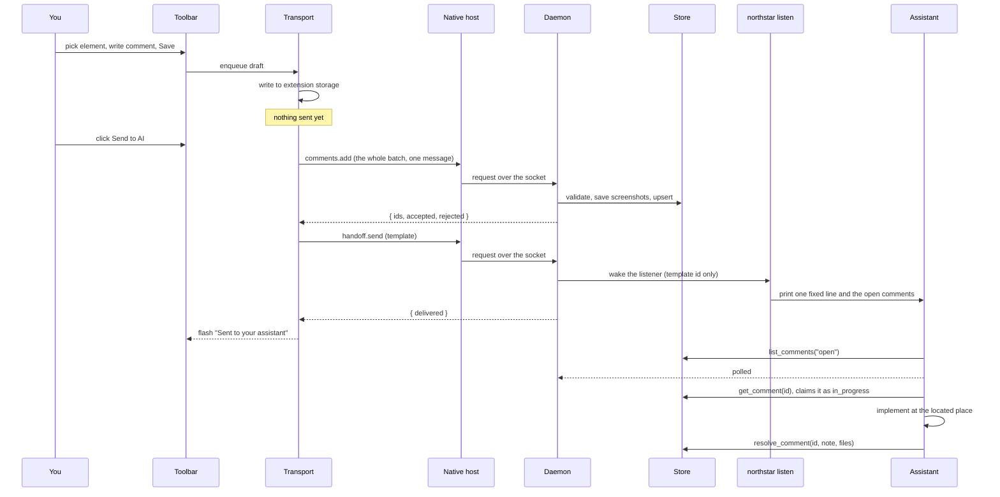
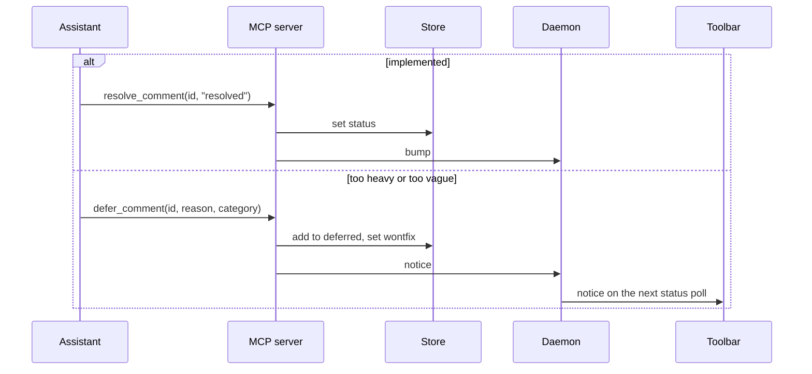
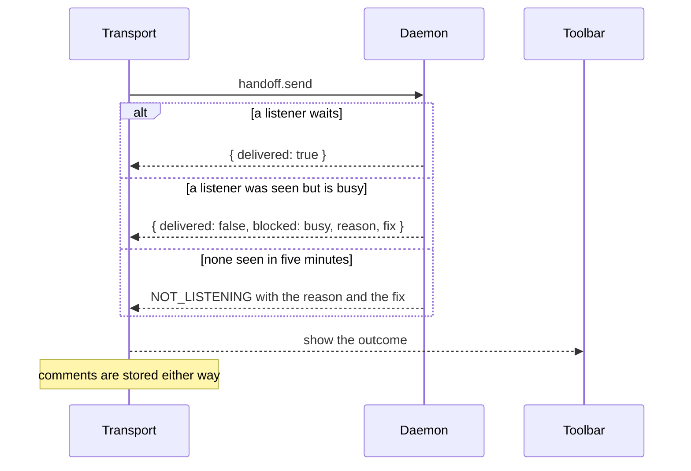
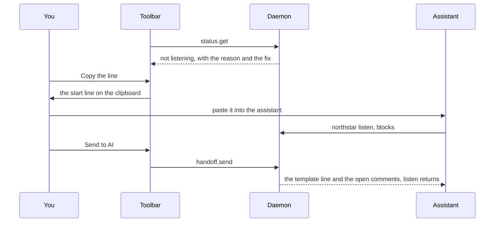

# Flows

These sequence diagrams show the message order for the three things Northstar does:
sending a batch, resolving or deferring work, and Northstar refusing to hand over. The
participants are the toolbar (in the content script), the extension transport layer, the
native host, the daemon, the listener, the comment store, and the AI assistant.

## 1. Capture a comment and send the batch

Saving a comment is local and instant. Sending is the moment data crosses to the
project and the moment your assistant is told about it.

Save enqueues, Send flushes. A comment that is only saved never reaches the
assistant, which is the single most common reason a batch looks like it was missed.

Delivery is automatic. You are only asked to act when Northstar must not go on, see
the next flow. Sending a selection from the context menu or the shortcut follows the
same path, with the selection stored as one comment first.

## 2. Resolve or defer

After working through a batch the assistant writes the outcomes back through the MCP
tools.

Deferrals split into two kinds: `needs-plan` for changes that are too heavy to do
inline, and `feedback` for comments too vague to act on. Both leave a notice in the
toolbar so you know they were parked, not dropped, and a plan is yours to make.

## 3. Nobody is listening

If no assistant has run `northstar listen` in the last five minutes, the comments are
still saved and the toolbar says that nothing was handed over, with the reason and the
fix. If the assistant is busy, the line is held for its next `northstar listen`.

The refusal is explicit: nothing is retried and nothing is sent a second way.

## 4. Starting the listener

When no listener runs in the project the toolbar says so and offers **Copy the line**,
which you press yourself. In Claude Code the `northstar-live` mod starts the listener
for you and this flow is never needed.

